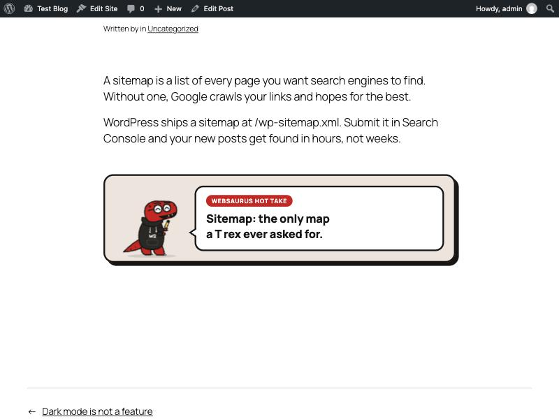
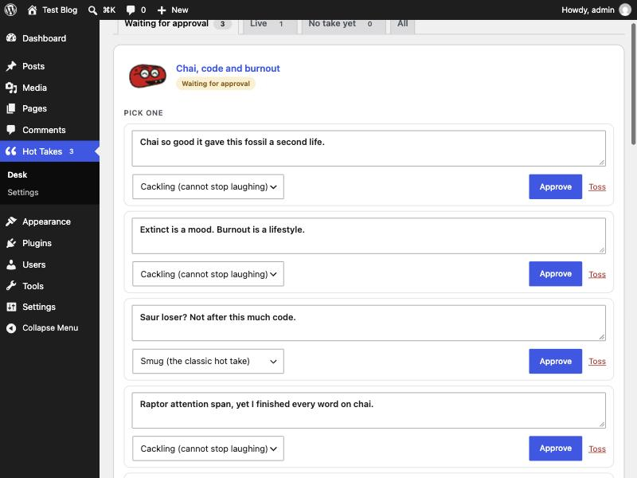

# Webosaurus Hot Take Box

A WordPress plugin that ends every post with a one line punny reaction from WebSaurus, the red T rex in nerd glasses. AI drafts a handful of takes on the whole article, a human approves the one that goes live. Think of the topical billboard a brand puts up the morning after big news, for your blog.



## How it works

1. **Publish a post.** Takes are drafted in the background (WP Cron).
2. **Approve on the Hot Take Desk** (Hot Takes > Desk), or in the Hot Take Box panel under the editor. Edit the line, pick a mood, press Approve.
3. **It goes live** at the end of the post. Press Pull to take it down any time.

Nothing reaches readers until someone with publish rights approves it. Authors can draft and toss, editors approve.



## Features

* **Randomized puns.** Every batch picks random comedy angles (Bollywood dialogue, cricket commentary, dinosaur puns, street food menu boards, deadpan headlines, Hinglish wordplay) plus a random seed, so drafting again really gives new jokes.
* **Seven mascot moods**, one per Lottie from [websaurus-lottie](https://websaurus-lottie.vercel.app): smug, hype, cackling, shocked, thinking, talk, idle. The AI picks a mood per take, you can change it. Readers can poke the dino to make it cackle.
* **Bring your own AI:** Anthropic Claude (default `claude-opus-5-5`), OpenAI, Google Gemini or Groq. With no key, an offline pun engine writes takes from the article keywords, no network calls.
* **Drafts from what you see.** In the editor, drafting uses your unsaved title and content.
* **Stale warning** when the post changes after drafting.
* **Rotation:** approve several takes and show a random one per visit.
* **Crawlable:** the take is plain HTML, works without JavaScript, and the animation loads lazily, deferred, only on posts with a live take. Reduced motion is respected.
* **No dashes:** an optional cleanup strips em dashes, en dashes and hyphenated words from drafts.

## Install

```bash
./build-zip.sh
```

Upload `dist/webosaurus-hot-take-box.zip` in Plugins > Add New > Upload, activate, then open Hot Takes > Settings.

API keys can also live in `wp-config.php`: `WHTB_ANTHROPIC_KEY`, `WHTB_OPENAI_KEY`, `WHTB_GEMINI_KEY`, `WHTB_GROQ_KEY`.

## Placement and styling

The box is appended after the post content. Turn that off in Settings and use `[webosaurus_hot_take]` (or `[webosaurus_hot_take id="123"]`).

Override these on `.whtb`: `--whtb-accent`, `--whtb-ink`, `--whtb-paper`, `--whtb-bubble`, `--whtb-mascot`.

## Hooks

* `whtb_pre_generate` (filter): return an array of `{text, mood}` to replace the built in writers.
* `whtb_takes` (filter): change approved takes before render.

## Develop

No build step: PHP plus plain JS on WordPress globals. Test in WordPress Playground:

```bash
npx @wp-playground/cli@latest server --port=9410 --mount=./webosaurus-hot-take-box:/wordpress/wp-content/plugins/webosaurus-hot-take-box --mount=./test:/seed --blueprint=./test/blueprint.json
```

```bash
sh test/smoke.sh
```

The test seed fakes the Anthropic API with a `pre_http_request` filter, so the real request path runs without a key or network.

## Privacy

When an AI provider is set, the post title and text are sent to that provider when takes are drafted. Nothing is sent from visitors' browsers, and nothing at all with the offline engine.

## Credits

WebSaurus Lotties by WhatTheWeb. Lottie player: [lottie-web](https://github.com/airbnb/lottie-web) 5.12.2, MIT.

## License

GPL v2 or later.
